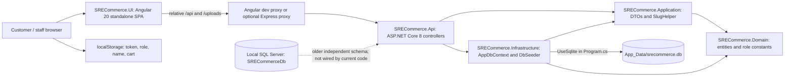

# SRECommerce architecture assessment

Audit date: 2026-10-28 (Asia/Calcutta). Status: audit completed; implementation not started.

This assessment follows Part 19 of the supplied master prompt. Application source, configuration, databases and installed services were inspected without changing them. Only audit documentation was added. No dependency installation, application startup, container creation, branch creation or migration was performed. Existing screenshots and build outputs are historical artifacts, not proof of current runtime behavior.

## 1. Existing architecture

This is a layered monolith with one deployable API and one Angular app. The four .NET project names suggest Clean Architecture, but controllers query the infrastructure DbContext directly and contain most business logic. Application has no implemented use-case boundary, repository abstraction or application-service orchestration. EF Core already supplies change tracking and a transaction per SaveChanges; an extra repository/unit-of-work layer should be introduced only for a concrete need.

## 2. Backend inventory

| Project | Target and references | Current responsibility |
| --- | --- | --- |
| SRECommerce.Api | net8.0; Domain, Application, Infrastructure | 10 controllers, JWT configuration, permissive CORS, Swagger, static uploads, startup seeding |
| SRECommerce.Application | net8.0; Domain | Six DTO files, SlugHelper, second PagedResult type |
| SRECommerce.Domain | net8.0; no project dependencies | Eight persisted entities, enums, role/status constants; mostly mutable data classes |
| SRECommerce.Infrastructure | net8.0; Domain, Application | One AppDbContext and a large demo seeder; SQLite EF provider |

API dependencies: BCrypt.Net-Next 4.0.3, JwtBearer 8.0.0, EF Core SQLite/Tools 8.0.0, Swashbuckle 6.6.2. Infrastructure also references SQLite 8.0.0 and BCrypt 4.0.3. No SQL Server EF provider, backend test project, migration source, custom middleware, messaging, cache, outbox, gateway, health endpoints or CI pipeline was found in the inspected source tree. WeatherForecast.cs and the HTTP request file remain template artifacts.

Source inventory excluding generated/build/dependency/artifact folders: 34 C# files with 2,124 nonempty lines; 48 TypeScript files with 2,522 nonempty lines; 20 HTML templates with 1,003 nonempty lines; 14 SCSS files with 408 nonempty lines. See [source inventory](source-inventory.md) for paths. These counts describe the current small monolith, not the much larger target scope.

## 3. Angular inventory

| Area | Implementation |
| --- | --- |
| Bootstrap | Standalone AppComponent, lazy loadComponent routes, zoneless change detection, fetch HTTP, hydration configuration |
| Public | Home, category/all-products listing, product details, cart and checkout |
| Account/auth | Login, registration, order history; template-driven forms |
| Staff/admin | Layout, live dashboard, categories, products, banners, home-section editor, home preview, users, order list |
| Shared | Header/category navigation, banner slider, deterministic client-side shopping chat |
| Core | Eight services, two guards, one auth interceptor, six model files; signals and computed values for local state |
| Styling | Global SCSS and CSS variables, responsive breakpoints, a separate older SCSS token set; no UI framework dependency |
| Server host | Angular SSR/Express packages and optional API proxy exist, but every configured server route uses RenderMode.Client |
| Tests | Three specs; two import files/classes that no longer exist; dashboard spec targets the older unused dashboard |

Routes: `/`, `/products`, `/c/:slug`, `/p/:slug`, `/cart`, `/login`, `/register`, `/account`, `/admin` and seven named admin child routes. The admin parent and child routes use the staff guard. This is one combined app; BusinessAdmin and SuperAdmin are not separate applications yet.

Preserve the existing route URLs, typed catalog/order contracts, lazy-loaded components, signals, admin editing workflows, product imagery, upload references and SRECommerce branding. Keep the SCSS approach initially. A framework replacement or Tailwind adoption has no demonstrated need in this audit.

## 4. Database inventory and divergence

See [database evidence and preservation plan](../database-migrations/assessment.md). The current source selects SQLite regardless of whether a SQL Server connection string is supplied. A provider switch requires code, schema and data planning; changing the connection string alone is insufficient.

| Data | SQLite exact count | SQL Server approximate metadata count |
| --- | ---: | ---: |
| Users | 3 | 3 |
| Categories | 20 | 6 |
| Products | 1,000 | 10 |
| Banners | 3 | 3 |
| HomeSections | 10 | 3 |
| HomeSectionItems | 21 | 17 |
| Orders | 3 | Table absent |
| OrderItems | 6 | Table absent |
| __EFMigrationsHistory | Table absent | 2 rows |

SQL Server has migrations `20251112184700_InitialCreate` and `20251218170914_AddHomeModule`, both recorded as EF 8.0.0. Their source files are missing from this workspace. SQLite was created with EnsureCreated, has eight business tables, and passed read-only integrity and foreign-key checks. Both stores must be preserved; neither has been declared the sole authoritative source.

## 5. Authentication and security

| Priority | Evidence | Consequence / required work |
| --- | --- | --- |
| High | AdminUsersController.cs:13 authorizes Roles.Staff; Create accepts Admin and ChangeRole allows Admin | Employees can create or promote administrators. Separate user-management permissions and test privilege boundaries before use beyond local development. |
| High | AdminUploadsController.cs:36 preserves the supplied extension and writes to publicly served uploads | No application file-type/signature allowlist or explicit image-size limit. Restrict, validate and safely serve uploads. GUID names alone do not validate content. |
| High | JwtOptions.cs:8 uses ExpiresMinutes; appsettings.json uses ExpiryMinutes | File configuration does not bind the intended 360-minute lifetime. Without an external override the property remains zero; login may issue an effectively expired token, subject to validation clock skew. Runtime behavior remains untested. |
| High | DbSeeder.cs:12/16 and Program.cs startup path | Schema preparation and demo account/catalog/order seeding run on every startup without an environment gate. Do not start this API during a read-only audit. |
| High | appsettings.json contains a JWT signing key; seeder contains fixed demo credentials | Move keys to secret configuration, rotate before wider use, and make demo credentials development-only. No secret values are copied into this report. Git history exposure cannot be assessed without Git metadata. |
| High | No TenantId, tenant resolver, membership model or tenant-aware authorization | Current system is single-tenant. Existing Admin is not equivalent to the proposed platform SuperAdmin. All service extraction must enforce tenant isolation before tenant onboarding. |
| Medium | AuthController.Me reads only the raw sub claim; JWT claim mapping is not explicitly configured | Potential mismatch with NameIdentifier mapping. Orders already supports both claim forms. Verify /auth/me under actual middleware before deciding the fix. |
| Medium | Registration/login compare emails without common normalization; DTOs have no explicit password/email validation rules | Registration/admin creation can disagree on identity uniqueness; implement normalized identity and ASP.NET Core Identity policies. |
| Medium | Browser token and role stored in localStorage; guards check presence/role; interceptor adds token to every outgoing request | No expiry-aware session state, origin restriction, refresh rotation or revocation; token storage is exposed to script access. Define the browser session/token design before extraction. |
| Medium | No lockout, MFA, email verification, password reset, session/audit model or rate limiter | Identity target is substantial new work, not a rename of the current controller. Logout currently only clears browser storage. |
| Medium | AllowAnyOrigin and RequireHttpsMetadata=false; Swagger exposed unconditionally | Development settings need explicit environment boundaries and restrictive production configuration. |
| Medium | Orders reads stock then writes without a concurrency token or reservation; no idempotency key | Concurrent requests can oversell or duplicate orders. A SaveChanges transaction does not protect the earlier stock read. |
| Medium | Product/category create checks slugs in code, but no database unique slug/SKU constraints; update has no duplicate check | Concurrent writes or updates can create ambiguous URLs/SKUs. Add validated tenant-scoped unique indexes after duplicate analysis. |
| Medium | OrderItems.Product foreign key uses cascade delete in actual SQLite schema | Deleting a product can remove historical order lines. Preserve order snapshots and replace cascade behavior through a reviewed migration. |

Additional gaps: pagination is not bounded server-side; parent category/product-category references are scalar IDs without configured foreign keys; order status changes are not implemented despite chat helper text suggesting them; shipping is hardcoded to 99; no payment processing exists. SQLite decimal aggregates in AdminReports require runtime verification because queries rely on provider translation. These are observed risks, not reproduced runtime failures.

## 6. Reuse and migration risks

- Reuse existing catalog/category CRUD contracts, search/sorting/pagination behavior, order price snapshots, dynamic homepage types, section ordering, banners and upload references after validation and tenant adaptation.
- Keep price and stock server-authoritative. Existing checkout recalculates prices from persisted products, which is a useful starting point, but needs concurrency and idempotency.
- Treat HomeSection StyleJson as migration input, not an approved theme schema. It currently mixes layout with colors and has no schema, contrast, version or publish validation.
- Existing home failure handling shows an error and clears sections; the header has demo category fallback. Neither is the required tenant-aware last-published theme/layout fallback chain.
- Separate Theme visual tokens from Storefront layouts through an explicit mapping. Preserve current appearance as a legacy preset, then offer business-specific presets.
- PagedResult exists in both Application.DTOs and Application.Models; auth DTOs also exist in two namespaces. Consolidate contracts carefully after compatibility tests.
- Unused dashboard and stale specs, several oddly named account-detail.component.scss files, and two token systems should be reconciled incrementally; do not delete first.
- There is no detected .git at the root, parents or immediate project directories. `git rev-parse` and `git status` fail. This may be an exported working folder. Recover/locate the original checkout and remote before creating a migration branch; do not initialize unrelated history and claim it preserves the original.

## 7. Environment and compatibility

| Item | Observed result |
| --- | --- |
| .NET | SDKs 8.0.404, 9.0.306 and 10.0.300-preview.0.26177.108, plus legacy SDKs; default SDK is the .NET 10 preview; no global.json |
| Runtime | ASP.NET/.NET 10.0.5 installed; multiple 8/9 runtimes also installed |
| Frontend | Node 22.15.0; npm 10.5.0; local Angular CLI 20.3.10, Angular 20.3.11, TypeScript 5.9.3, RxJS 7.8.2; lockfile v3 |
| Docker | CLI 28.3.3 and Compose 2.39.2; desktop-linux context cannot reach the engine pipe; Docker service stopped |
| SQL Server | Running MSSQL22 instance; SQL Server 2022 Developer 16.0.1000.6; Full-Text installed; Windows-auth read queries succeeded |
| SQL networking | Shared-memory query and TCP localhost:1433 both succeed against MSSQL22; SQL Browser stopped; container path/certificates/authentication not verified |
| Broker/cache | No matching RabbitMQ/Redis/Kafka Windows service or listener on 5672/15672/6379/9092 observed. Docker containers cannot be inventoried while engine is unavailable; installation absence is not established. |
| Capacity | 4 logical CPUs, 7.8 GiB physical RAM, about 0.8 GiB free at inspection; about 59.7 GiB C: and 50.1 GiB D: free |

Recommend stable .NET 10 LTS for newly approved services, paired with compatible EF/JWT packages and a pinned stable SDK. A stable .NET 10 SDK is not currently installed. Preserve the net8 monolith until a separately tested upgrade is approved. .NET 8 support ends 2026-11-10; .NET 10 LTS is supported into November 2028. [Official .NET policy](https://dotnet.microsoft.com/en-us/platform/support/policy/dotnet-core).

Current Angular 20.3/Node 22.15/TypeScript 5.9/RxJS 7.8 versions satisfy the published compatibility ranges. Angular 20 LTS ends 2026-11-28. Plan a separate supported-version upgrade, one major at a time; Angular 22 requires a newer Node patch and TypeScript major than those installed. Do not combine this with database extraction. [Compatibility](https://angular.dev/reference/versions), [release policy](https://angular.dev/reference/releases).

## 8. Verification and limits

| Check | Result |
| --- | --- |
| Source/configuration inventory | Completed; no AGENTS.md found in checked ancestor/workspace source locations |
| dotnet --info; node/npm versions; local ng version | Completed; observations above |
| docker version; docker compose version | Client/Compose identified; engine connection failed |
| SQL SELECTs: server properties, SRE database schema/index/history metadata | Passed over Windows authentication; TCP connectivity also passed |
| SQLite DatabaseSync readOnly:true, PRAGMA integrity_check | Passed: ok |
| SQLite PRAGMA foreign_key_check | Passed: zero rows |
| node node_modules/typescript/bin/tsc --noEmit --incremental false -p tsconfig.app.json | Passed, exit 0 |
| Same command for tsconfig.spec.json | Failed, exit 2: TS2307 for ./app and ./account imports |
| Backend build/tests, Angular template compilation/production build/Karma/browser tests | Not run in this read-only phase; no passing claim |
| Application/API startup and migration tests | Not run: startup mutates database; require approved isolated baseline |
| Vulnerability/dependency/production-license audit | Not completed; old package versions are recorded, not certified safe |

The TypeScript app check does not compile Angular templates or verify a deployable bundle. SQL metadata counts are approximate. No private user records, password hashes, token values or unrelated database content were extracted.

## 9. Proposed boundaries, migration, effort and next task

See [migration plan](migration-plan.md), [proposed technology decisions](../decisions/0001-incremental-modernization-proposal.md), [API inventory](../api-contracts/existing-api.md) and [infrastructure proposal](../runbooks/local-development-proposal.md).

Recommended next task: one baseline-stabilization phase in the recovered Git checkout, before Identity extraction. Its proposed scope is concrete in the migration plan and awaits approval.

Planning estimate, not a delivery commitment: baseline/data preservation 3-6 engineering days; complete Identity slice 15-25 days; Tenant slice 10-18 days; Theme and Storefront 10-18 days each; catalog/inventory/pricing/cart/order/payment/shipping/notification/discovery 8-20 days each with scope-dependent increases for checkout/payment/stock; Manufacturing 15-30 days; three frontend areas, cross-service failure testing and operational hardening another 60-110 days. Overall full prompt scope is roughly 220-420 engineering days for one experienced full-time developer; learning, part-time work, approval waits and production integrations extend calendar time. Re-estimate after the baseline and first service. The current ~6,000-line app is reusable, but it does not already implement the target SaaS requirements.

Checkpoint: **WAITING_FOR_USER_APPROVAL**. No microservice is approved or implemented by this audit.
