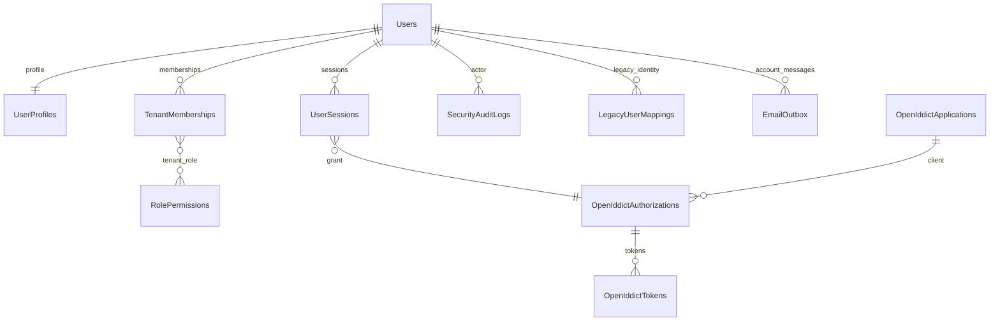

# Identity service design

Status: implementation approved by the owner after the verified baseline. Scope: Identity only; no Tenant service, gateway or Angular module is authorized by this phase.

## Domain and projects

`Backend/Services/Identity/SRECommerce.Identity.{API,Application,Domain,Infrastructure,Tests}`. Domain owns profile/account state, tenant memberships, sessions, permissions and auditing. Infrastructure adapts ASP.NET Core Identity, SQL Server EF Core, OpenIddict, durable local email delivery and legacy password verification. Application defines contracts and ports; API composes authentication, authorization and HTTP contracts. The legacy projects remain in their own solution and retain their provider/data.

Use stable .NET SDK 10.0.403 and Microsoft Identity/EF packages 10.0.14. Install the SDK locally under ignored artifacts with the official SHA512 checked. OpenIddict 7.7.2 is Apache-2.0; ASP.NET Core Identity/EF are Microsoft MIT packages. Confirm selected package metadata after restore. Use a separate Backend solution/SDK pin so the existing .NET 8 baseline remains buildable.

## Protocol and authorization

Use OAuth2/OIDC authorization code with mandatory PKCE, short-lived signed access tokens, rotating stored refresh tokens and explicit revocation. No resource-owner-password grant or homemade refresh-token protocol. Server-hosted login forms use Identity cookies and antiforgery; bearer APIs use OpenIddict validation plus current account/session state. Only configured first-party redirect URIs are allowed. Production requires HTTPS and configured signing/encryption certificates. Development certificates are local and never committed.

Platform SuperAdmin is distinct from the legacy Admin. Tenant roles/permissions are evaluated against current memberships and a tenant selected during the validated authorization flow. Headers cannot select a tenant. Domain tenant records use query filters; privileged platform operations explicitly bypass filters only under SuperAdmin authorization and write audit records. There is no cross-service foreign key to a future Tenant database. Tenant existence/lifecycle integration remains a contract dependency until Tenant is approved.

## Data ownership and ER diagram

Create only `SRECommerce_IdentityDB` for the approved service. Identity framework/OpenIddict tables remain service-owned implementation details. Keep the old SQLite and SRECommerceDb untouched.

Tenant membership uniqueness is `(TenantId, UserId)`; permission uniqueness is `(TenantId, Role, Permission)`. Session/authorization IDs are stable GUID/string references. SQL rowversion protects membership/session updates. Users have normalized unique emails through Identity. Legacy mapping uniqueness is `(Source, LegacyId)` and prevents re-import overwrites. Account activation, password changes and membership changes must invalidate affected sessions.

## Legacy migration

Read a consistent existing backup, not live cross-service tables. Prepare an ignored JSON snapshot and dry-run report before import. Preserve legacy IDs in mapping rows; never replace source data. Existing BCrypt hashes use a clearly tagged compatibility verifier and are rehashed with Identity on successful verification. Do not mark legacy emails verified, silently assign a tenant, or convert legacy Admin into platform SuperAdmin. Imported accounts require confirmation and explicit membership provisioning before tenant access. Import is idempotent and transactional; conflicting normalized emails stop the import for review. Authority/frontend cutover is not part of the import rehearsal.

## Email and infrastructure

Persist account email jobs in the Identity transaction. Deliver only through local Mailpit during development; SMTP outage leaves retryable jobs rather than losing reset/verification messages. This is an Identity adapter, not an implicitly created Notification service. No broker/cache/Kafka is needed for this service's first slice. Do not send real external email. Store tokens/data-protection keys outside Git and redact credentials/tokens in logs.

## Completion gates

Apply reviewed EF migrations to the approved development database and an isolated integration-test database. Verify account/role/session/email/MFA/PKCE/refresh/revocation/tenant boundaries against SQL Server; verify malformed/expired/replayed credentials and email outage behavior. Provide OpenAPI, health checks, a multi-stage Dockerfile, minimal opt-in infrastructure configuration, scripts, ERD/schema/index descriptions, restore evidence, contracts and a completion report. Any unverified requirement remains pending. Stop after Identity and request the owner's next choice.
