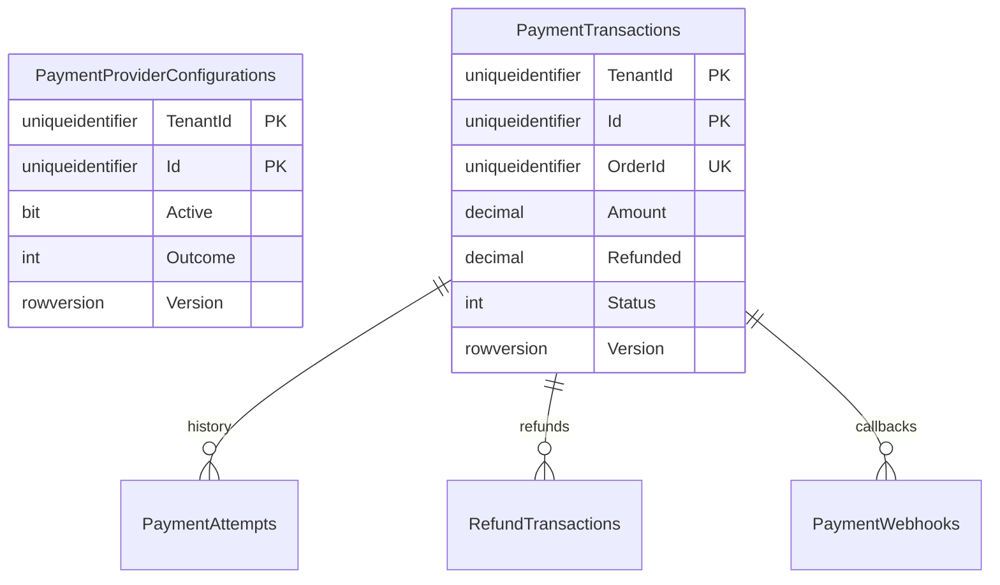

# Payment service

Payment owns its database and uses the authenticated Order HTTP context as the source of the amount, currency, currency precision, customer and payment method. There is no cross-database access and no browser-supplied price. Only scoped Order machine identity can initiate, capture, abort or refund. Recovery reads, aborts and refunds remain available after module disablement; new charges require current module access. Humans have role-checked management/read endpoints, with audited support reasons for platform access.

Only the local Sandbox provider is implemented. UPI/Card/NetBanking are simulated authorization flows and COD is a simulated post-delivery settlement. No card number, CVV, bank credentials, live payment SDK or real money is accepted. Provider receipts are deterministic and persisted atomically with the local ledger. A live provider would require its own durable external-call intent/recovery adapter and explicit authorization; it cannot be enabled by changing tenant configuration.

## SQL ownership

All business tables have tenant filters and composite tenant keys. Foreign keys stay within PaymentDB. Each tenant/order has one payment, each refund ID and webhook event ID is unique within its tenant, and payment attempts have a unique monotonic payment sequence. Serializable transactions, SQL rowversion and a touched aggregate revision guard concurrent captures and refunds. Financial facts and receipt/history rows are immutable. Check constraints bound amounts, refund/status relationships, currency precision and sandbox provider identity. Audit/outbox rows are saved with each mutation; broker delivery is a separate infrastructure phase.

An abort creates a cancelled payment fence even if initiation has not arrived yet. A later initiation cannot resurrect it. Captured payments retain their captured balance for an explicit refund. Refunds allocate only the unrefunded captured balance, obey the original currency precision and require an exact ID/amount/reason tuple for replay. COD capture requires an authoritative delivered/completed Order state; this remains a sandbox settlement rather than proof of actual cash collection.

## Verified callback boundary

Sandbox callbacks contain an event ID, payment ID, exact amount/currency and Authorized/Declined outcome. The signature is HMAC-SHA256 over tenant ID, timestamp and exact UTF-8 body. Its private signing key belongs in user-secrets/environment, never SQL responses, Angular or Git. A five-minute timestamp window, fixed-time MAC comparison, strict body schema, bounded body size, tenant-scoped receipt hash and state guards prevent forged/conflicting/replayed events from changing terminal payments. A valid late event is retained as unapplied history. The owner/manager sandbox decision endpoint uses this same verifier and retains human audit identity. Missing signing configuration fails closed.

Reconciliation compares the local sandbox provider reference, immutable attempt sequence, refund sum and current balance; it reports inconsistencies without inventing payment success or rewriting history. It does not claim to reconcile a real bank account.

## Migration and UI

Initial and additive precision migrations are source artifacts. Apply only reviewed scripts to the owning development database after isolated tests, with backup/restore verification. Startup never migrates automatically. The Angular Payments workspace exposes method settings, pending sandbox decisions, state filters, payment/refund history and reconciliation. Refund requests are coordinated through the Order workflow. Runtime credential provisioning and publishing remain on their existing holds.
