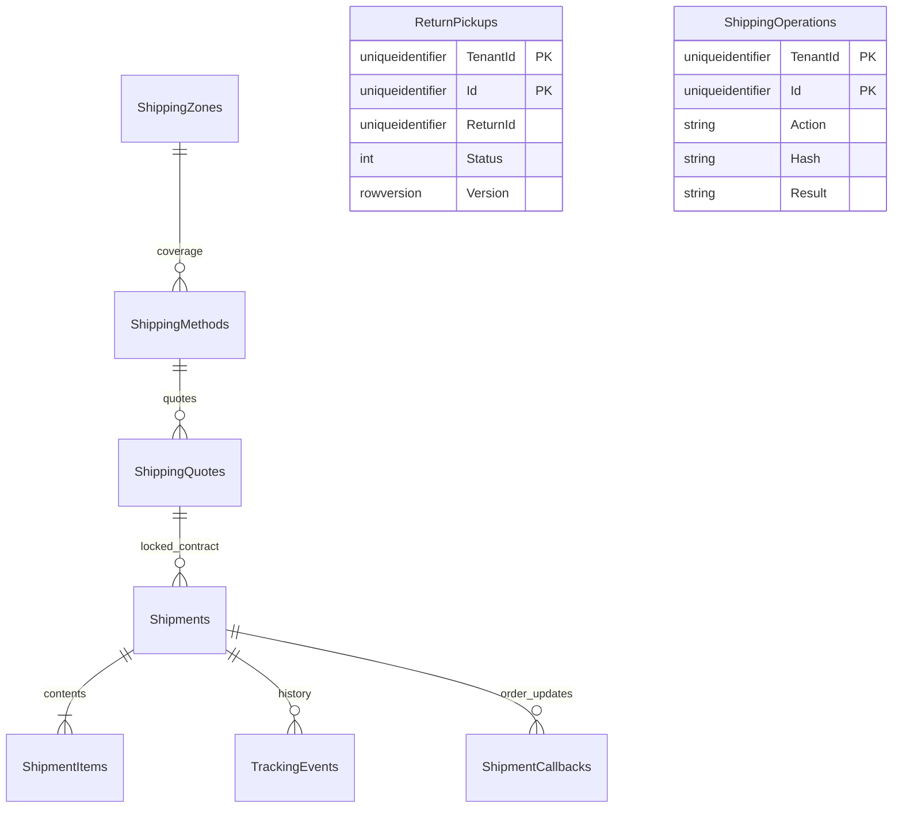

# Shipping ownership and delivery flow

Shipping owns zones, methods/delivery rules, quote snapshots, parcels/items, tracking, return pickups and durable Order callback state. It does not own prices, stock, payments or Order fulfillment quantities. All tables have tenant filters/composite ownership keys and only intra-service foreign keys.

The nine business tables plus audit/outbox/inbox and EF history make thirteen tables. Configuration uses rowversion, tenant/code uniqueness and explicit soft deactivation. Money uses decimal(18,4), quantities decimal(18,3). Check constraints validate method types, pickup warehouse requirements, fees, quantities, JSON and pickup windows. Quotes, operation receipts, tracking events and parcel item/recipient snapshots are immutable. Active/collected pickups have a filtered unique tenant/return index; cancelling a pickup permits a new scheduling record without rewriting history.

## Quote authority

Shipping reads Cart through a dedicated Shipping-only preparation verification route. Guest cart capability and authenticated customer/role bindings remain mandatory. The preparation supplies the currency, precision, item quantities and current item total used for shipping eligibility and free thresholds. The browser supplies no price or subtotal. Zones match configured countries/postal prefixes; fees are configured base + per-unit, with explicit tax and bounded eligibility. Pickup warehouses are validated in a bounded single Inventory lookup. Public option responses omit private warehouse identities.

Order's internal quote contract retains the exact preparation ID and customer binding. An identical set of items in a different preparation cannot reuse that quote. New Order validation checks the quoted destination, currency, quantities, expiry and active delivery configuration. Once accepted, paid fulfillment uses the locked shipping snapshot rather than charging a later configuration price. The source APIs enforce that Shipping's Cart/Inventory scopes allow preparation/warehouse reads but cannot claim carts or reserve/commit stock.

## Fulfillment and recovery

Only Order can create parcels, using its authoritative fulfillment context and committed warehouse allocation. Shipping verifies quantities, current warehouse eligibility and the locked destination/pickup route. Local/store-pickup movements are role-checked operator actions; the courier adapter is explicitly SandboxCourier and contacts no carrier. Shipment states are Created → Packed → Dispatched → Delivered, with pre-dispatch cancellation and delivery exception/reattempt support. A reattempt does not send another quantity-dispatch callback.

Each dispatch/delivery/cancellation persists an ordered callback row before network work. The callback obtains the current Order fulfillment version, saves its exact request document, then sends outside SQL transactions. Stable operation IDs, SQL rowversion, bounded leases/backoff and Order receipts make a lost HTTP response replay-safe. Later callbacks wait for earlier acknowledgement. Exhausted callbacks enter manual review and a manager can requeue them; the stored request cannot be changed. No bearer token or guest secret is persisted in callback state.

Customer tracking revalidates ownership through Order on every request, forwarding the current customer bearer or guest Order capability only to the fixed local/configured Order service. Management reads require current staff membership; mutations require manager/owner, configuration owner, and platform support requires an audited reason. Existing callback recovery does not depend on public storefront/module availability.

Return pickup requires an approved, non-historical Order return and an active receiving warehouse. Collection records logistics only. Order's quality/receipt/refund workflow separately controls returned stock and money. Cancelled pickups can be rescheduled with a new identity; collected returns cannot be double-collected.

## Verification and limits

Fourteen isolated SQL/API cases pass across real implemented commerce services. They include authoritative fees, guest proof, route/scoped identity boundaries, quote preparation binding, partial delivery, response loss after Order commit, queued outage recovery, COD after delivery, pickup cancellation/reschedule, immutable snapshots and a 100% promotion plus free shipping. A zero-total Order produces a zero-charge receipt and cannot refund nonexistent captured money.

Main Shipping schema and Payment's zero-charge check-constraint expansion were reviewed/applied with verified backups/restores. Runtime client provisioning, broker delivery and external carriers remain separate; neither successful isolated tests nor an outbox row claims these are configured. Publishing is held at the owner's request.
