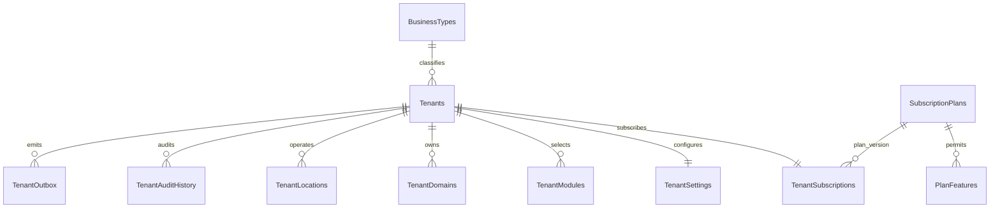

# Tenant Management service design

Status: owner explicitly selected Tenant Management backend on 2026-10-29. Scope is this backend, its owned SQL database/migrations/tests and the minimal Identity HTTP contract needed for integration. No frontend, gateway or further service is approved. GitHub push still requires separate approval.

## Ownership and deployment

Five projects: `SRECommerce.Tenant.API`, `.Application`, `.Domain`, `.Infrastructure`, `.Tests` under `Backend/Services/Tenant`. Own database `SRECommerce_TenantDB` on the existing Windows SQL instance; no replacement SQL container or cross-service table reads/foreign keys. Shared service database with tenant-key query filters initially; dedicated database routing is a future strategy, not a claim of implemented provisioning.

Own business registration/onboarding, business-type catalog, lifecycle, settings, branding metadata, locations, domains, module configuration, plan catalog, subscriptions/limits, effective entitlements and audit history. Theme appearance, billing/payment collection and Identity memberships stay with their owning services.

## Identity boundary

Identity adds `tenant_api` scope/resource and an authenticated `/api/v1/me/access` context endpoint. Tenant forwards the bearer token only to a configured trusted Identity base URI; Identity validates its standard OpenIddict token/session and returns current account kind, stored platform role, selected active membership, scopes and audiences. Tenant requires both `tenant_api`/`srecommerce.tenant` and the Identity context scope; caller-supplied role/tenant headers are ignored. Production requires HTTPS for the Identity hop; local HTTP is Development-only. Timeout or Identity outage fails closed with 503. No unvalidated JWT parsing or cached authorization decision substitutes for the current Identity check.

Tenant-context mutations require the selected active Owner/Manager membership, or a current stored platform administrator with an audited bypass. Billing-plan changes, activation/suspension and domain approval are platform operations. Pending onboarding is visible only to its registering owner/platform administrator; active business management requires a real Identity membership.

Activation first idempotently provisions an active, email-confirmed owner through Identity's privileged HTTP endpoint using the current administrator's delegated token, then commits Tenant activation. An owner disabled after submission cannot pass this provisioning step. No database transaction spans services. If Identity fails, activation stays pending; if Tenant commit fails after provisioning, no active Tenant access is granted and retry converges. This is documented orchestration, not an invented distributed transaction.

## Data and invariants

Tenant IDs/owners are GUID references, with no Identity FK. Unique slug and `(owner, registration request ID)` support safe onboarding retries. SQL rowversion and explicit expected versions protect changes. Serializable writes protect location/domain limits and plan changes from concurrent requests. Tenant settings, modules, subscription, locations, domains, audits and outbox carry TenantId and query filters; privileged cross-tenant queries are explicit/audited.

Business types: spices, clothing, grocery, general-store, custom (custom label required). Plan/module/feature catalog is configuration metadata; no real charge/payment/subscription provider is invoked. Subscription validity and suspension affect effective entitlements. This service enforces its own location/domain/module constraints; future owning services must enforce their respective user/storage/order limits through the entitlement contract.

Domains are normalized DNS names, globally unique and pending until ownership verification. No incoming Host header is accepted as proof of tenant identity. Branding stores a display name/logo URL; rendering CSS/themes is outside this service. Locations are archived/deactivated rather than deleted. Writes atomically append audit and minimal lifecycle/configuration outbox events; broker dispatch is deferred until an approved consumer exists.

## Schema and indexes

`TenantPlatformAudit` independently records global plan/catalog and platform-list operations. `__EFMigrationsHistory` tracks schema version. These thirteen tables belong only to Tenant. `OwnerUserId`/audit actor IDs reference external Identity identifiers without a cross-database FK.

SQL unique indexes protect slug, owner/request idempotency, domain host, module key and plan/feature key. A filtered unique domain index permits at most one active primary domain per tenant. Rowversion is on the tenant aggregate so child/configuration changes share its expected-version contract. Location activity, owner/status, audit chronology and pending outbox indexes support the implemented queries. Large-tenant query plans/throughput remain a later measured verification step, not a local smoke-test claim.

## Verification plan

Real SQL migrations/constraints/rowversion tests and HTTP integration tests cover onboarding retries/conflicts, cross-tenant denial, header spoofing, revoked credentials, Identity outage, lifecycle/owner provisioning, plan expiration/limits, settings/branding validation, locations/domains/modules and audit/outbox atomicity. Keep isolated test DBs and source stores. Generate/review idempotent SQL, apply only to the approved database, verify backup/restore and image build/runtime prerequisites. Stop after a truthful completion report and owner checkpoint.
