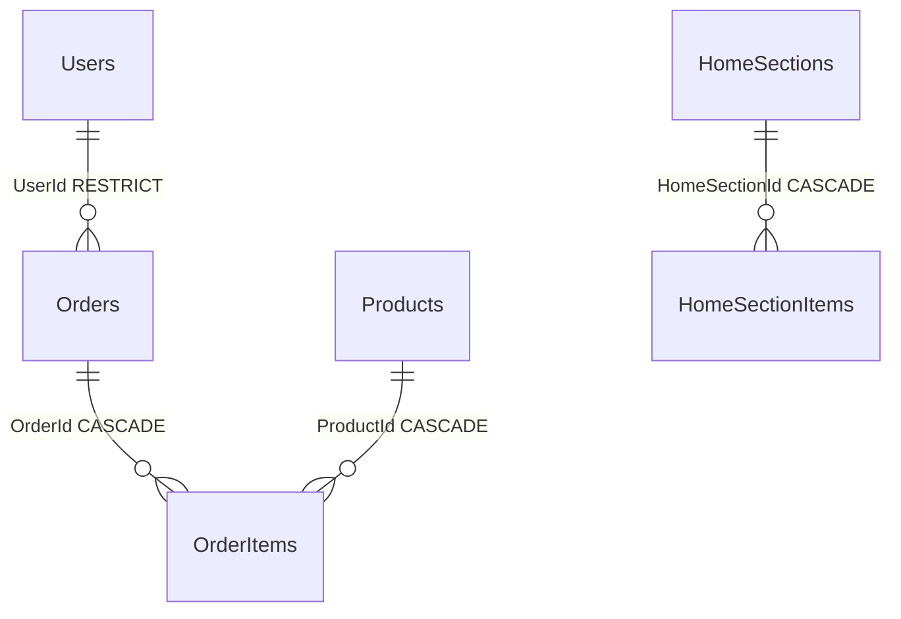

# Database evidence and preservation plan

Audit: 2026-10-28. Read-only evidence; no migrations or data changes applied.

## Current entities and relationships

| Entity/table | Fields / relationship notes |
| --- | --- |
| Users | Integer Id; FullName, Email, BCrypt PasswordHash, one string Role, CreatedAt. Current EF model has a unique Email index; actual older SQL schema does not. |
| Categories | Integer Id; Name, Slug, optional ParentId/ImageUrl. ParentId is not configured as a self-reference. |
| Products | Integer Id; Name/Slug/Sku, Price/Discount, StockQty, CategoryId, ImageUrl, CreatedAt. No navigation/constraint to Category in the current actual SQLite schema. |
| Banners | Integer Id; title/image, enum link type/value, enabled/order. |
| HomeSections | Integer Id; type/title/enabled/order, item count, cards per row, source key and StyleJson. |
| HomeSectionItems | Integer Id; section FK, polymorphic EntityType/EntityId, enabled/order. Section cascade delete; no target FK for the polymorphic entity. |
| Orders | Integer Id; User FK with restricted delete, customer/contact/address snapshots, status, shipping/subtotal/discount/total, timestamp and item collection. |
| OrderItems | Integer Id; Order/Product FKs, product/name/SKU/image snapshots, unit price/discount/quantity/line total. SQLite cascades both Order and Product deletion. |

Diagram shows enforced SQLite relationships only. Product.CategoryId, Category.ParentId and polymorphic section targets are scalar references without enforced target FKs. The older SQL Server database lacks Orders/OrderItems entirely.

## Read-only checks executed

SQL Server connection: `.\MSSQL22`, Windows integrated authentication, sqlcmd connection timeout 5 seconds, command timeout 10 seconds. Queries read SERVERPROPERTY edition/version/full-text, sys.databases restricted to `SRE%`, sys.tables/partitions/columns/indexes in SRECommerceDb, migration history, and the current connection's transport. A separate TCP localhost,1433 query verified the instance identity. `-C` trusted the local certificate for this development audit; this does not verify a production trust chain.

Observed: Developer Edition (64-bit), version 16.0.1000.6, Full-Text installed; SRECommerceDb ONLINE. SQL Server has six business tables and two historical migrations. Its catalog/image nullability and indexes differ from the current model; notably Categories.ImageUrl is required varchar(200) there, and Users lacks the unique Email index configured in current EF source.

SQLite path: `SRECommerce.Legacy.API/SRECommerce.Api/App_Data/srecommerce.db`. Opened using Node 22's experimental `node:sqlite` DatabaseSync with `readOnly:true`; only schema/count queries and PRAGMAs ran. Integrity: `ok`. Foreign-key check: empty result. Eight business tables, no EF migration-history table. Monetary values are stored using SQLite TEXT affinity; target SQL decimal conversion needs explicit invariant parsing and rounding checks.

Counts are recorded in the main assessment. No password hashes or individual user/contact/address records were returned. No claim is made that the two stores have matching user IDs just because their user counts match.

## Preservation and migration prerequisites

- Keep both existing stores and their migration history. Recover the two historical migration files from the original Git repository/backups; do not fabricate equivalent history.
- Confirm effective runtime configuration after the baseline is isolated. Configuration files show SQLite, but environment/user-secret overrides were not disclosed by this audit.
- A consistent SQLite backup and SQL Server COPY_ONLY backup/restore rehearsal must precede migration. A successful file copy is not proof of recoverability.
- Verify orphaned scalar IDs, duplicate normalized email/slugs/SKUs, invalid amounts/stock, decimal conversion, image paths and tenant mappings before defining target unique constraints.
- Export legacy IDs into controlled mapping tables/files for reconciliation. Keep current order snapshots and financial totals intact.
- Give each service its own SQL Server database, DbContext, migrations and credentials. Existing host engine can hold all approved logical databases. Do not install another engine.
- Use TenantId on tenant-owned rows, global query filters plus authorization, tenant-composite unique indexes and rowversion for protected writes. Identity may have platform-wide users while membership and permissions remain tenant-scoped.
- Catalog owns product/variant identity; Inventory owns balances/reservations; Pricing owns live prices. Order stores historical snapshots and external IDs. No cross-database foreign keys or direct reads.
- Inventory transfer needs a reconciled opening balance and reservation/cutover protocol. Database rowversion alone is not a distributed reservation workflow.
- No migration can be marked complete until development apply/verification, rollback or forward recovery, and cross-tenant tests run successfully.

SQL Server Developer is appropriate only for development/test, not production; [Microsoft edition guidance](https://learn.microsoft.com/en-us/sql/sql-server/editions-and-components-of-sql-server-2022/). If SQL Server 2022 Express is considered later, assess its 10 GB relational database limit, CPU/memory limits and feature availability against the chosen hosting plan. Hosting, backups and production licensing are separate costs.

Checkpoint: WAITING_FOR_USER_APPROVAL; backup/restore and provider migration are pending.
